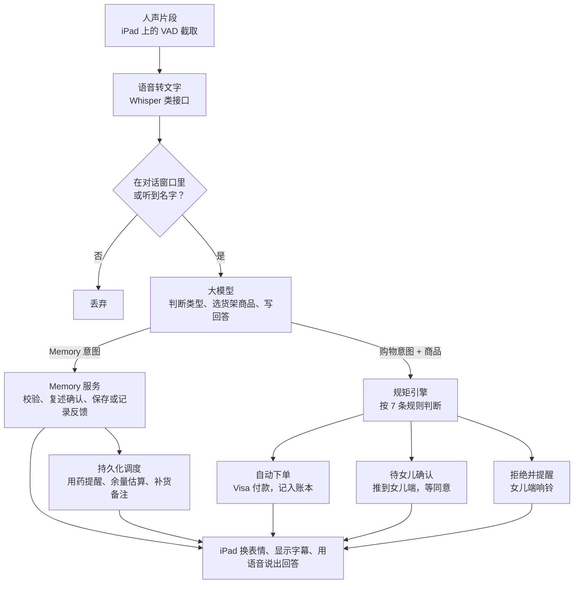

# TrustTag PRD

2026-10-17

这份 PRD 定义比赛版本要做出来的东西：三幕演示里出现的每一个动作都要真实跑通，周日 10:00 提交。产品为什么这样设计见 [产品方案.md](产品方案.md)。

## 范围

比赛版本只服务一个家庭：一台老人端 iPad、一个女儿端手机、一个后端。

**要做：**

- 喊自定义名字唤醒、语音对话、表情和字幕。
- 听懂家里话、判断四类请求（补货、新需求、诈骗、货架外）。
- Memory：保存用户确认过的用药日期和规则，到点提醒，记录服用反馈，并生成余量和提前补货备注。
- 规矩引擎：单笔上限、每月额度、关闭品类。
- 可信货架：约 50 个人工核验过的商品。
- 女儿端购物页面和 Memory 管理，和 iPad 实时同步。
- 付款走 Visa 沙盒，接不上时用模拟付款并标明。

**不做：**

- 真实发货、物流追踪、退货。
- 多个家庭、多个家人账号、登录注册。
- 离线唤醒、方言、中文对话（演示用英文）。
- 自动上架商品和自动查询认证，货架是手工整理的。
- 推断或建议用药剂量、漏服处理、药物相互作用判断、复杂递减或按需用药自动排程、处方药交易。
- Memory 的离线闹钟、锁屏推送，以及商家实时库存或真实送达时间预测。

## 用户故事和验收标准

U1–U6 覆盖原有三幕购物演示；U7–U10 覆盖第一幕接入的 Memory 功能，全部通过才算完成。

| 编号 | 故事 | 验收标准 |
| --- | --- | --- |
| U1 | 奶奶喊名字，设备开始听 | 喊名字后 1.5 秒内脸变成「在听」；安静房间里 10 次至少唤醒 9 次；正常聊天 10 分钟误唤醒不超过 1 次 |
| U2 | 奶奶用家里话补货 | 「the purple bottle」对应到女儿教过的那个商品；额度内奶奶说「yes」后自动下单；女儿账本 2 秒内出现新记录 |
| U3 | 奶奶转述医生的要求，AI 推荐商品 | 「my doctor says I need more vitamin D」推荐货架上有 USP 认证的维生素 D；第一次买的商品进入待确认，卡片上带认证来源 |
| U4 | 女儿确认大额订单 | 女儿点同意后 2 秒内 iPad 告诉奶奶已下单，脸变成开心；点拒绝时 iPad 温和地告知 |
| U5 | 奶奶遇到诈骗 | 提到礼品卡、转账、「有人打电话让我买」时拒绝；脸变红；女儿手机 2 秒内响铃并弹出提醒 |
| U6 | 奶奶要货架外的商品 | 「the miracle joint pills from TV」被拒绝，说明原因，推荐货架上有 USP 或 NSF 认证的替代品；女儿收到通知 |
| U7 | 奶奶告诉 AI 用药安排 | AI 复述药品、具体日期、时间、时区、每次数量和原话备注，奶奶确认后才保存；缺字段先追问；两端 2 秒内同步，刷新页面及重启后端后仍在 |
| U8 | 到点提醒并记录反馈 | 前台联网且空闲时，到点后 10 秒内显示字幕并播报；「已服用」只记一次，「这次跳过」不扣余量，「稍后提醒」只推迟通知；没回应显示未确认；重连、重启不产生重复扣减 |
| U9 | 提前备注可能需要补货 | 使用下方演示数据，预计余量进入 3 天阈值后出现一条备注，注明计算依据和核对时间；缺余量时只提示核对；足够覆盖结束日期时不提示补货；不自动创建订单 |
| U10 | 更正或停止记忆 | 两端都能查看、更正、暂停或删除；更正复述确认后生效；暂停或删除后旧定时任务不再触发，更正后按新版本生成未来提醒 |

## 老人端功能需求

老人端是一个全屏网页，竖屏显示，用 iPad 的引导式访问锁住。

| 编号 | 需求 | 细节 |
| --- | --- | --- |
| E1 | 开启麦克风 | 第一次打开时由团队点一次「开始」授权麦克风和声音播放，之后不再需要碰屏幕 |
| E2 | 人声检测 | 浏览器里跑 Silero VAD，一段话说完（停顿 0.6 秒）就把这段音频发到后端 |
| E3 | 喊名字唤醒 | 待机时只有转写文字里含唤醒名字才响应；名字和同音变体由后端匹配；名字后面紧跟的话直接当作第一句请求 |
| E4 | 对话窗口 | 唤醒后或 AI 说完话后 10 秒内不用再喊名字；10 秒没声音回到待机 |
| E5 | AI 说话时不听 | AI 播放声音期间暂停人声检测，避免听到自己的声音 |
| E6 | 七种表情 | 待机、在听、在想、在说、开心、担心、警报；用 SVG 动画，状态切换过渡 0.3 秒；待机时不显示脸，全屏轮播家庭照片，每张 10 秒，听到名字后照片淡出、脸出现 |
| E7 | 字幕 | 奶奶的话灰色 28px；AI 的回答白色 44px，最多两行；价格和日期 64px |
| E8 | 商品卡片 | 推荐或下单时显示商品图、名称、价格、「Verified」标记和认证来源 |
| E9 | 说话 | 后端返回的回答用语音合成播放，语速偏慢 |
| E10 | 实时收消息 | 女儿同意、拒绝、改名字时，iPad 不用刷新就能收到并做出反应 |
| E11 | 键盘输入 | 屏幕右上角长按 3 秒打开隐藏输入框，打字代替说话，只给团队调试和现场救场用 |
| E12 | AI 身份说明 | 每次启动后第一次对话先说「I'm Lin, an AI helper.」 |
| E13 | 用药记忆确认 | 通过语音建立、查询、更正、暂停和删除 Memory；先读回待保存的安排，缺失或有歧义的字段先追问 |
| E14 | 用药提醒和反馈 | 到点展示药品名称、确认过的规则和本次时间并播报；接受已服用、跳过、稍后提醒；提醒播报后沿用 10 秒对话窗口，只操作明确对应的提醒，指代不清时先确认 |
| E15 | 余量和补货备注 | 可口述实际剩余数量；显示预计耗尽日期、估算依据和最后核对时间；补货备注为普通提示，用户提出购买后才进入原购物流程 |

## 女儿端功能需求

女儿端是手机网页 App（PWA），底部四个标签：首页、账本、教 AI、设置。

| 编号 | 页面 | 需求 |
| --- | --- | --- |
| D1 | 首页 | 上方显示本月已花 / 额度；下方是待确认订单和最新提醒，按时间倒序 |
| D2 | 待确认卡片 | 商品图、价格、妈妈的原话、AI 的推荐理由、同意和拒绝两个按钮 |
| D3 | 提醒 | 诈骗和货架外请求时全屏红色弹窗 + 提示音 + 手机震动；显示妈妈原话和「打电话给妈妈」按钮（tel: 链接） |
| D4 | 账本 | 每笔订单：时间、商品、金额、状态（自动下单 / 已确认 / 已拒绝 / 已拦截） |
| D5 | 教 AI | 上传一张照片 + 一句说法（「the purple bottle」），从货架里选对应商品保存；照片由视觉模型自动推荐货架上最像的商品；列表可删除 |
| D6 | 设置·规矩 | 单笔自动下单上限、每月额度、品类开关（食品、日用、保健品、电器、居家安全） |
| D7 | 设置·唤醒名字 | 输入新名字，保存后 iPad 马上生效；输入框下方显示起名字建议 |
| D8 | 设置·付款 | 显示绑定的 Visa 沙盒卡尾号；模拟付款时显示「Simulated」 |
| D9 | 教 AI·Memory | 查看安排、来源原话、确认人、日期、时区、服用反馈、剩余量及备注；可以编辑确认、暂停、恢复、删除和重新清点余量，改动实时同步 iPad |
| D10 | 首页·日常提醒 | 显示今天待处理的用药提醒和补货备注；使用普通卡片，不响诈骗警报；未回应标为未确认，不能显示为已服用或确认漏服 |

设置里还有「家庭照片」：上传和删除照片，保存后 iPad 待机轮播马上更新。

## Memory 规则

Memory 独立于最近 10 条聊天记录，写入 SQLite 后长期保留。比赛版限定为固定日期、每日或每周指定星期、每天一个或多个固定时刻，使用同一条已确认的每次数量和单位。

1. **录入与确认**：老人或家人提供药品名称、开始日期、结束日期（或明确选择持续至暂停）、时间、家庭时区、每次数量与单位、原话备注。相对日期转换为具体日期；「饭后」作为原话备注保留，同时询问提醒时刻。大模型只能提取草稿，普通代码校验字段后，复述并取得确认才启用。含糊、不支持的规则保留为待补充草稿，不排程、不预测库存。
2. **来源与范围**：记录原话、录入人、确认人和时间。购买完成可以邀请创建 Memory，但不自动生成服法。已有药品可仅以名称记录，product_id 可为空；这类记录不能触发货架外购买。首次开启需说明家人可见并取得老人同意；随时可暂停或删除。
3. **提醒调度**：后端每 5 秒检查到期任务，日程按家庭 IANA 时区计算，落地为 UTC 时刻；夏令时重复时刻只提醒一次，不存在的时刻标为需核对，不擅自挪动。每条提醒用 plan_id + plan_version + scheduled_at 唯一标识，并保留当时数量、单位和规则的快照，入库后再发送；重启从数据库恢复，客户端按 reminder_id 去重。
4. **反馈与过期**：播报不等于服用。明确确认才标为 taken，跳过标为 skipped；稍后提醒使用用户指定时间，未指定则追问，只改 next_notify_at，且必须早于 expires_at。已服用或已跳过后不能重复处理，误记通过有来源的更正恢复。未回应保持 pending；到下一次计划时刻或当日结束时（取较早者）标为 expired，页面仍显示「未确认」，不自动补播旧的服药指令，也不建议补服。
5. **更新与暂停**：修改先保存带独立 draft_version 的草稿，旧版本在新版本确认前仍生效；确认请求必须匹配所复述的草稿版本，否则重新确认。确认后增加 plan version，原子取消旧版未完成提醒并仅生成生效时间之后的新任务，保留历史反馈；已到期未确认的历史提醒保留为 expired，不能因改计划而消失或再次播报。暂停立即取消未来提醒并关闭补货备注；恢复需确认日期且不补发过去时段。删除时移除计划及其草稿、提醒、余量、补货备注和包含该安排的原话记录，后续不再向模型检索这些内容。
6. **手头余量与预测**：以用户在 stock_as_of 清点的 stock_quantity 为基准，只用此后明确确认的服用量和更正记录计算账面余量；未知反馈不当作已服用。在「按安排使用」的预测中，扣除清点后已确认服用、未确认的过去计划用量，并按未来日程逐次扣减，已跳过的不扣。预测与账面余量分开显示；未确认次数、最后清点时间和假设都要注明，不把预测称作实际余量。单位必须一致，不把 mg 擅自换算成粒；结果低于零时显示需重新清点，不显示负库存。
7. **补货备注**：找到预测余量首次不足以覆盖的计划时刻，作为预计不足日期；与今天的家庭时区日历日期相差不超过提前天数时生成一条可更新的备注，默认提前 3 天且可修改，不按跨夏令时的小时数折算。无明确数量、日程或单位时，只提示核对。结束日期内所有计划都能覆盖时不建议续购。备注不创建订单、不付款；用户提出补货后仍经过原有七条购买规则。订单成功也不增加库存，用户收货后重新确认手头总数；条件消失、计划暂停或完成时关闭旧备注，避免反复提示。
8. **提醒可用性**：比赛演示两端保持前台联网、音频已授权。正在对话或播报时排队，空闲后播报尚未过期的提醒；断网、页面后台或未获播放权限时保留记录并显示设备状态。回到页面读取未处理状态，过期的只显示「未确认」。普通用药和库存提示不使用红色诈骗警报，不承诺离线、锁屏或医疗级提醒送达。

## 一句话的处理流程

没喊名字也不在对话窗口里的话直接丢弃；购物结果经过规矩引擎，Memory 操作经过字段校验与对应的确认流程。定时任务独立于语音输入运行，提醒和补货备注同步两端。

## 规矩引擎的判断规则

大模型只负责理解和推荐，买不买由规矩引擎用普通代码判断，按下表从上往下匹配，命中第一条就停。

| 顺序 | 条件 | 结果 | iPad 表情 | 女儿端 |
| --- | --- | --- | --- | --- |
| 1 | 大模型判断为诈骗 | 拒绝 | 警报 | 红色提醒并响铃 |
| 2 | 商品不在货架上 | 拒绝，推荐货架上的替代品 | 担心 | 提醒 |
| 3 | 商品品类被女儿关掉 | 拒绝 | 担心 | 提醒 |
| 4 | 本月已花 + 本单金额 > 每月额度 | 待确认 | 担心 | 待确认卡片 |
| 5 | 本单金额 > 单笔上限 | 待确认 | 担心 | 待确认卡片 |
| 6 | 这个商品以前没买过 | 待确认 | 担心 | 待确认卡片 |
| 7 | 其他情况 | 奶奶说「yes」后自动下单 | 开心 | 账本多一条 |

待确认的订单 24 小时没处理就自动取消。所有金额用美分整数存储。

## 数据结构

所有数据存在后端一个 SQLite 文件里，共十一张表：原有七张，加四张 Memory 表。

| 表 | 字段 | 用途 |
| --- | --- | --- |
| settings | wake_name, wake_variants, per_order_limit_cents, monthly_limit_cents, blocked_categories, daughter_phone, timezone, memory_consent_at | 家庭设置，只有一行；Memory 启用前确认时区和共享同意 |
| products | id, name, brand, category, price_cents, image_url, merchant, certifications, verified_at, description | 可信货架 |
| aliases | id, phrase, product_id, photo_url, created_at | 女儿教的家里说法 |
| orders | id, product_id, qty, amount_cents, status, elder_quote, ai_reason, payment_ref, created_at, decided_at | 订单和待确认 |
| alerts | id, kind, elder_quote, ai_reason, created_at, seen_at | 诈骗和货架外提醒 |
| turns | id, role, text, intent, created_at | 对话记录，大模型取最近 10 条当上下文 |
| medication_plans | id, product_id (nullable), item_name, source_order_id (nullable), source_text, created_by, confirmed_by, confirmed_at, start_date, end_date (nullable), schedule_json, dose_quantity, dose_unit, instructions, timezone, status, version, draft_json, draft_version, stock_quantity (nullable), stock_unit, stock_as_of, refill_lead_days, created_at, updated_at | 持久用药记忆；草稿与生效版本分开，库存为用户清点的基准 |
| medication_reminders | id, plan_id, plan_version, scheduled_at, next_notify_at, expires_at, dose_quantity, dose_unit, instructions_snapshot, status, delivered_at, created_at | 每次提醒、当时规则及送达状态；UNIQUE(plan_id, plan_version, scheduled_at) |
| medication_events | id, plan_id, reminder_id (nullable), kind, quantity (nullable), unit, occurred_at, recorded_at, actor, source_text, supersedes_event_id (nullable), idempotency_key | 已服用、跳过、稍后提醒、数量清点与更正；幂等键唯一，库存计算只取有效记录 |
| refill_notes | id, plan_id, status, estimated_shortfall_at (nullable), projected_remaining (nullable), unconfirmed_count, basis_json, note, checked_at | 每个计划最多一条 open 备注，更新而非反复新增；无足够数据时说明待核对 |

orders.status 取值：auto_placed、pending、approved、declined、expired。alerts.kind 取值：scam、off_shelf、blocked_category。另有 family_photos 表（id, image_url, created_at）存女儿上传的家庭照片。

medication_plans.status 为 draft、active、paused、completed；medication_reminders.status 为 pending、snoozed、taken、skipped、expired、cancelled，送达状态不能替代服用状态。schedule_json 包含 recurrence（dates / daily / weekly）、dates 或 weekdays、times；开始和结束日期按计划时区解释且包含当天。refill_notes.status 为 open、resolved。完成最后一个计划时刻后停止生成任务，并在其提醒处理或过期后将计划标为 completed。时间戳用 UTC，日历日期和原时区保留；数量以相同单位的定点数处理。

## 接口和实时消息

两端都通过 HTTP 接口写数据，通过 WebSocket 收实时消息。

| 接口 | 谁调用 | 作用 |
| --- | --- | --- |
| POST /api/utterance | iPad | 上传一段音频（或键盘文字）和当前是否在对话窗口；返回转写文字、是否唤醒、回答文字、表情、商品卡片、语音音频地址；Memory 操作另返回 plan_id / reminder_id、待确认草稿和缺失字段 |
| GET /api/state | 两端 | 取设置、本月已花、待确认订单、最新提醒，以及今日 Memory 提醒和未关闭补货备注 |
| GET /api/orders | 女儿端 | 账本列表 |
| POST /api/orders/:id/decision | 女儿端 | 同意或拒绝；同意时发起付款 |
| POST /api/aliases | 女儿端 | 上传照片 + 说法；返回货架上最像的 3 个商品 |
| PUT /api/aliases/:id | 女儿端 | 确认对应的商品 |
| DELETE /api/aliases/:id | 女儿端 | 删除说法 |
| PUT /api/settings | 女儿端 | 改额度、品类、唤醒名字；家庭照片用 POST / DELETE /api/photos |
| GET /api/products | 两端 | 可信货架列表 |
| GET /api/memory | 两端 | 读取用药安排、待确认草稿、服用反馈、余量估算和补货备注 |
| POST /api/memory/plans | 两端 | 创建草稿，返回规范化字段、缺失字段和复述内容，不立即启用 |
| PATCH /api/memory/plans/:id | 两端 | 提交修改草稿；携带 version，冲突时返回 409 并重新确认，禁止覆盖较新的安排 |
| POST /api/memory/plans/:id/confirm | 两端 | 携带 version 和 draft_version 确认所复述的草稿；字段完整才激活或替换日程，确认与重新排程在一个事务内完成 |
| POST /api/memory/plans/:id/pause、/resume | 两端 | 暂停或确认恢复；携带 version；取消或重建未来任务，不补发过去时段 |
| DELETE /api/memory/plans/:id | 两端 | 删除计划及关联数据并通知两端清除本地状态 |
| POST /api/memory/reminders/:id/response | 两端 | 提交 taken / skipped / snoozed 反馈；带 idempotency_key，稍后提醒需 next_notify_at；终态不能重复确认 |
| POST /api/memory/plans/:id/stock | 两端 | 用户确认手头总数量、单位、清点时间；幂等更新库存基准，重算补货备注，不能与订单数量自动相加 |
| POST /api/memory/events/:id/correction | 两端 | 更正错误反馈，保留来源并引用旧事件；在事务里重算库存，要求幂等键 |

语音和页面操作调用同一套 Memory 服务；用药安排的保存与更改必须经过上述草稿确认。Memory 写接口均校验启用同意、版本和幂等性，模型不能直接写数据库。补货按钮只创建购买请求，走原有规则，不直接付款。

WebSocket 消息（服务器发向两端）：

- order.created、order.decided：订单新建和女儿做出决定，iPad 收到 order.decided 后说出结果。
- alert.created：女儿端响铃。
- settings.updated：iPad 更新唤醒名字。
- memory.updated、memory.deleted：两端更新或清除指定计划、草稿及其提醒。
- reminder.due、reminder.updated：带 reminder_id 和 plan_version，触发普通提醒或同步反馈；客户端去重并忽略已失效版本。
- refill.updated：更新或关闭补货备注，女儿首页和 iPad 普通提示同步，不触发诈骗警报。

## 技术选型

一个仓库、一个后端服务，两个前端页面由同一个服务提供。

| 部分 | 选用 | 原因 |
| --- | --- | --- |
| 前端 | React + Vite，路由 /elder 和 /family | 两端共用组件和类型 |
| 后端 | Node.js + Express + Socket.IO | HTTP 和实时消息在同一个服务里 |
| 数据库 | SQLite（better-sqlite3） | 一个文件，不用部署数据库 |
| Memory 调度 | 同一 Node.js 后端内的 5 秒轮询 + SQLite 持久化任务 | 确认后的结构化日程驱动提醒，重启恢复；不依赖大模型记住对话或前端计时器 |
| 人声检测 | @ricky0123/vad-web（Silero VAD） | 在浏览器里跑，只上传有人说话的片段 |
| 语音转文字 | Whisper 类接口 | 英文准确率高，一句话 1 秒左右 |
| 理解和推荐 | Claude Sonnet 5.5，用 tool use 返回结构化结果 | 输出意图、商品 id、回答、理由，不自由发挥 |
| 照片识别（教 AI） | Claude 看图 | 和货架商品图比对 |
| 语音合成 | TTS 接口，选一个温和、语速偏慢的声音 | 浏览器自带的声音太机械 |
| 付款 | Visa 开发者平台沙盒 | 赛道要求 |
| 部署 | 带 HTTPS 的云服务器 | iPad Safari 只在 HTTPS 下允许用麦克风 |

大模型每次收到：转写文字、最近 10 条对话、女儿教的全部说法、可信货架列表、过去的订单；Memory 请求另按当前药品或提醒检索相关已确认记录和草稿，不注入所有健康记录。购物只能从货架列表里选商品 id；Memory 可记录未上架药品的名称，但不能生成可购买的商品 id。日期排程和余量计算由普通代码完成。

## 演示数据

演示前把下面的数据写进数据库，每次排练前用一个重置脚本恢复。

**设置**：唤醒名字 Lin；单笔自动下单上限 30 美元；每月额度 200 美元；本月已花 46 美元；电器品类关闭。

| 用在哪一幕 | 数据 | 要求 |
| --- | --- | --- |
| 第一幕 | 一瓶紫色包装的钙片，说法「the purple bottle」，带一张女儿拍的照片 | 价格低于 30 美元；有一条以前的订单 |
| 第二幕 | 一款有 USP Verified 标记的维生素 D | 没有以前的订单，按第一次购买进入待确认 |
| 第三幕 | 一款有 USP Verified 标记的关节保健品 | 拒绝「miracle joint pills」时作为替代品推荐 |
| 平时 | 其余约 47 个保健品和营养品：复合维生素、鱼油、益生菌、蛋白粉、老年营养奶粉、叶黄素等 | 每个商品记录商家和认证来源 |

商品的具体品牌、价格和认证由负责货架的队员在商家官网和认证机构名单上逐个核对后填入。

**Memory 演示夹具（仅示例，不是用药建议）**：使用第一幕已有商品，设家庭时区 America/Los_Angeles，2026-10-18 08:00 前清点余量 14 粒；用户给出的示例规则为 10 月 18 日至 11 月 1 日每天 08:00 记录 1 粒，提前 3 天备注。英文演示逐项复述并确认；期间若每天都确认已服用，10 月 29 日 08:00 确认后剩 2 粒，能覆盖 30–31 日，首次不足为 11 月 1 日 08:00。10 月 29 日进入提前 3 个日历日的阈值，生成一条备注并更新余量。把结束日期改为 10 月 31 日并确认后，备注关闭，因为余量足以覆盖全部剩余安排。

隐藏调试面板可推进演示时钟，必须显示「Demo time」，触发同一套真实调度和计算逻辑。重置脚本一并重置 Memory、确认记录和时钟；额外检查缺数量、未回应、跳过、重复确认、暂停、删除、断线重连及重启恢复。新订单不增加手头余量，直到用户确认收货后的实际总量。

## 速度、稳定、隐私要求

| 方面 | 要求 |
| --- | --- |
| 速度 | 奶奶说完话到 AI 开口不超过 3 秒；等待期间脸显示「在想」 |
| 稳定 | 任何一步失败（转写、大模型、付款）都在后端日志里写明原因，iPad 说「Sorry, can you say that again?」，不下单 |
| 稳定 | 大屏幕可以打开一个调试面板，实时显示转写文字、意图和规矩引擎的判断 |
| 隐私 | 没喊名字时的音频和转写文字不保存 |
| 隐私 | 密钥只放在后端环境变量里，不进前端代码，不进仓库 |
| 隐私 | Memory 先说明家人可见并取得老人同意；公开仓库和演示只用虚构数据；常规日志不记录完整用药原话；删除同步清除计划相关原话、事件与客户端缓存 |
| 安全 | 大模型不给医疗建议；只能返回货架上的商品 id，返回货架外的 id 时后端直接报错 |
| 安全 | Memory 不推断剂量、疗程、漏服处理或是否适合服用；保存安排、标记已服用和发起补货是三个独立动作；提醒失效或未确认不能显示为已完成 |
| 稳定 | Memory 写入成功后才说已记住；存储或调度失败明确显示未保存 / 提醒不可用；服务端事务、版本和幂等键防止重复任务、重复扣量和覆盖更新 |
| 显示 | iPad 上所有文字不小于 28px，文字和背景对比度至少 7:1 |

## 分工

四个人各负责一块，周六 12:30 开工后的第一个小时四个人一起确认接口字段和 WebSocket 消息格式，之后各自开发。

| 分工 | 负责的需求 | 交付物 | 用到别人的 | 完成标准 |
| --- | --- | --- | --- | --- |
| 老人端 | E1–E15；电子相框外壳打印（最多 6 小时） | /elder 页面；装好 iPad mini 的相框 | POST /api/utterance、Memory 接口、WebSocket 消息 | U1 通过；U2–U10 里 iPad 的表情、字幕、语音和 Memory 操作正确 |
| AI 和后端 | 规矩引擎 7 条规则；全部接口和 WebSocket；十一张表；Memory 调度和余量计算；语音转文字、大模型、语音合成、Visa 沙盒；演示数据重置脚本 | 部署在 HTTPS 地址上的后端服务 | 可信货架商品数据 | 只用键盘输入和接口调用就能跑通 U2–U10，重启后记忆与任务恢复 |
| 女儿端 | D1–D10；家庭照片上传 | /family 页面，可以装到手机桌面 | 全部女儿端接口、WebSocket 消息 | U2、U4、U5、U6 里女儿端的部分通过，风险提醒 2 秒内响铃；U7–U10 的 Memory 数据 2 秒内同步 |
| 路演和 Devpost | 可信货架约 50 个商品（品牌、价格、商家、认证来源）；演示数据；关键数据逐条核对 | 演示剧本、幻灯片、演示视频、Devpost 文字 | 三幕全部跑通后才能录视频 | 周六 22:30 交 Devpost 草稿；周日 10:00 带视频提交 |

## 待定问题

- [ ] Visa 沙盒用哪个接口，周六上午问 Visa 现场导师
- [ ] 语音转文字、语音合成各用哪家服务，谁的账号付费
- [ ] 部署在哪个云服务器
- [ ] 演示时奶奶由谁扮演，女儿的手机用谁的
