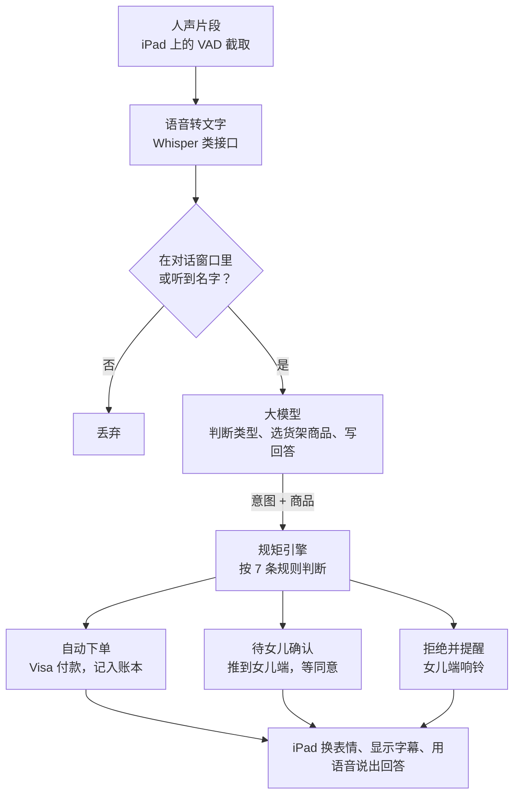

# TrustTag PRD

2026-10-17

这份 PRD 定义比赛版本要做出来的东西：三幕演示里出现的每一个动作都要真实跑通，周日 10:00 提交。产品为什么这样设计见 [产品方案.md](产品方案.md)。

## 范围

比赛版本只服务一个家庭：一台老人端 iPad、一个女儿端手机、一个后端。

**要做：**

- 喊自定义名字唤醒、语音对话、表情和字幕。
- 听懂家里话、判断四类请求（补货、新需求、诈骗、货架外）。
- 规矩引擎：单笔上限、每月额度、关闭品类。
- 可信货架：约 50 个人工核验过的商品。
- 女儿端六个页面，和 iPad 实时同步。
- 付款走 Visa 沙盒，接不上时用模拟付款并标明。

**不做：**

- 真实发货、物流追踪、退货。
- 多个家庭、多个家人账号、登录注册。
- 离线唤醒、方言、中文对话（演示用英文）。
- 自动上架商品和自动查询认证，货架是手工整理的。

## 用户故事和验收标准

六条故事全部通过，三幕演示就能从头跑到尾。

| 编号 | 故事 | 验收标准 |
| --- | --- | --- |
| U1 | 奶奶喊名字，设备开始听 | 喊名字后 1.5 秒内脸变成「在听」；安静房间里 10 次至少唤醒 9 次；正常聊天 10 分钟误唤醒不超过 1 次 |
| U2 | 奶奶用家里话补货 | 「the purple bottle」对应到女儿教过的那个商品；额度内奶奶说「yes」后自动下单；女儿账本 2 秒内出现新记录 |
| U3 | 奶奶转述医生的要求，AI 推荐商品 | 「my doctor says I need more vitamin D」推荐货架上有 USP 认证的维生素 D；第一次买的商品进入待确认，卡片上带认证来源 |
| U4 | 女儿确认大额订单 | 女儿点同意后 2 秒内 iPad 告诉奶奶已下单，脸变成开心；点拒绝时 iPad 温和地告知 |
| U5 | 奶奶遇到诈骗 | 提到礼品卡、转账、「有人打电话让我买」时拒绝；脸变红；女儿手机 2 秒内响铃并弹出提醒 |
| U6 | 奶奶要货架外的商品 | 「the miracle joint pills from TV」被拒绝，说明原因，推荐货架上有 USP 或 NSF 认证的替代品；女儿收到通知 |

## 老人端功能需求

老人端是一个全屏网页，竖屏显示，用 iPad 的引导式访问锁住。

| 编号 | 需求 | 细节 |
| --- | --- | --- |
| E1 | 开启麦克风 | 第一次打开时由团队点一次「开始」授权麦克风和声音播放，之后不再需要碰屏幕 |
| E2 | 人声检测 | 浏览器里跑 Silero VAD，一段话说完（停顿 0.6 秒）就把这段音频发到后端 |
| E3 | 喊名字唤醒 | 待机时只有转写文字里含唤醒名字才响应；名字和同音变体由后端匹配；名字后面紧跟的话直接当作第一句请求 |
| E4 | 对话窗口 | 唤醒后或 AI 说完话后 10 秒内不用再喊名字；10 秒没声音回到待机 |
| E5 | AI 说话时不听 | AI 播放声音期间暂停人声检测，避免听到自己的声音 |
| E6 | 七种表情 | 待机、在听、在想、在说、开心、担心、警报；用 SVG 动画，状态切换过渡 0.3 秒；待机时不显示脸，全屏轮播家庭照片，每张 10 秒，听到名字后照片淡出、脸出现 |
| E7 | 字幕 | 奶奶的话灰色 28px；AI 的回答白色 44px，最多两行；价格和日期 64px |
| E8 | 商品卡片 | 推荐或下单时显示商品图、名称、价格、「Verified」标记和认证来源 |
| E9 | 说话 | 后端返回的回答用语音合成播放，语速偏慢 |
| E10 | 实时收消息 | 女儿同意、拒绝、改名字时，iPad 不用刷新就能收到并做出反应 |
| E11 | 键盘输入 | 屏幕右上角长按 3 秒打开隐藏输入框，打字代替说话，只给团队调试和现场救场用 |
| E12 | AI 身份说明 | 每次启动后第一次对话先说「I'm Lin, an AI helper.」 |

## 女儿端功能需求

女儿端是手机网页 App（PWA），底部四个标签：首页、账本、教 AI、设置。

| 编号 | 页面 | 需求 |
| --- | --- | --- |
| D1 | 首页 | 上方显示本月已花 / 额度；下方是待确认订单和最新提醒，按时间倒序 |
| D2 | 待确认卡片 | 商品图、价格、妈妈的原话、AI 的推荐理由、同意和拒绝两个按钮 |
| D3 | 提醒 | 诈骗和货架外请求时全屏红色弹窗 + 提示音 + 手机震动；显示妈妈原话和「打电话给妈妈」按钮（tel: 链接） |
| D4 | 账本 | 每笔订单：时间、商品、金额、状态（自动下单 / 已确认 / 已拒绝 / 已拦截） |
| D5 | 教 AI | 上传一张照片 + 一句说法（「the purple bottle」），从货架里选对应商品保存；照片由视觉模型自动推荐货架上最像的商品；列表可删除 |
| D6 | 设置·规矩 | 单笔自动下单上限、每月额度、品类开关（食品、日用、保健品、电器、居家安全） |
| D7 | 设置·唤醒名字 | 输入新名字，保存后 iPad 马上生效；输入框下方显示起名字建议 |
| D8 | 设置·付款 | 显示绑定的 Visa 沙盒卡尾号；模拟付款时显示「Simulated」 |

设置里还有「家庭照片」：上传和删除照片，保存后 iPad 待机轮播马上更新。

## 一句话的处理流程

没喊名字也不在对话窗口里的话直接丢弃；大模型的结果全部经过规矩引擎，三种结果都会回到 iPad 上告诉奶奶。

## 规矩引擎的判断规则

大模型只负责理解和推荐，买不买由规矩引擎用普通代码判断，按下表从上往下匹配，命中第一条就停。

| 顺序 | 条件 | 结果 | iPad 表情 | 女儿端 |
| --- | --- | --- | --- | --- |
| 1 | 大模型判断为诈骗 | 拒绝 | 警报 | 红色提醒并响铃 |
| 2 | 商品不在货架上 | 拒绝，推荐货架上的替代品 | 担心 | 提醒 |
| 3 | 商品品类被女儿关掉 | 拒绝 | 担心 | 提醒 |
| 4 | 本月已花 + 本单金额 > 每月额度 | 待确认 | 担心 | 待确认卡片 |
| 5 | 本单金额 > 单笔上限 | 待确认 | 担心 | 待确认卡片 |
| 6 | 这个商品以前没买过 | 待确认 | 担心 | 待确认卡片 |
| 7 | 其他情况 | 奶奶说「yes」后自动下单 | 开心 | 账本多一条 |

待确认的订单 24 小时没处理就自动取消。所有金额用美分整数存储。

## 数据结构

所有数据存在后端一个 SQLite 文件里，共七张表。

| 表 | 字段 | 用途 |
| --- | --- | --- |
| settings | wake_name, wake_variants, per_order_limit_cents, monthly_limit_cents, blocked_categories, daughter_phone | 家庭设置，只有一行 |
| products | id, name, brand, category, price_cents, image_url, merchant, certifications, verified_at, description | 可信货架 |
| aliases | id, phrase, product_id, photo_url, created_at | 女儿教的家里说法 |
| orders | id, product_id, qty, amount_cents, status, elder_quote, ai_reason, payment_ref, created_at, decided_at | 订单和待确认 |
| alerts | id, kind, elder_quote, ai_reason, created_at, seen_at | 诈骗和货架外提醒 |
| turns | id, role, text, intent, created_at | 对话记录，大模型取最近 10 条当上下文 |

orders.status 取值：auto_placed、pending、approved、declined、expired。alerts.kind 取值：scam、off_shelf、blocked_category。另有 family_photos 表（id, image_url, created_at）存女儿上传的家庭照片。

## 接口和实时消息

两端都通过 HTTP 接口写数据，通过 WebSocket 收实时消息。

| 接口 | 谁调用 | 作用 |
| --- | --- | --- |
| POST /api/utterance | iPad | 上传一段音频（或键盘文字）和当前是否在对话窗口；返回转写文字、是否唤醒、回答文字、表情、商品卡片、语音音频地址 |
| GET /api/state | 两端 | 取设置、本月已花、待确认订单、最新提醒 |
| GET /api/orders | 女儿端 | 账本列表 |
| POST /api/orders/:id/decision | 女儿端 | 同意或拒绝；同意时发起付款 |
| POST /api/aliases | 女儿端 | 上传照片 + 说法；返回货架上最像的 3 个商品 |
| PUT /api/aliases/:id | 女儿端 | 确认对应的商品 |
| DELETE /api/aliases/:id | 女儿端 | 删除说法 |
| PUT /api/settings | 女儿端 | 改额度、品类、唤醒名字；家庭照片用 POST / DELETE /api/photos |
| GET /api/products | 两端 | 可信货架列表 |

WebSocket 消息（服务器发向两端）：

- order.created、order.decided：订单新建和女儿做出决定，iPad 收到 order.decided 后说出结果。
- alert.created：女儿端响铃。
- settings.updated：iPad 更新唤醒名字。

## 技术选型

一个仓库、一个后端服务，两个前端页面由同一个服务提供。

| 部分 | 选用 | 原因 |
| --- | --- | --- |
| 前端 | React + Vite，路由 /elder 和 /family | 两端共用组件和类型 |
| 后端 | Node.js + Express + Socket.IO | HTTP 和实时消息在同一个服务里 |
| 数据库 | SQLite（better-sqlite3） | 一个文件，不用部署数据库 |
| 人声检测 | @ricky0123/vad-web（Silero VAD） | 在浏览器里跑，只上传有人说话的片段 |
| 语音转文字 | Whisper 类接口 | 英文准确率高，一句话 1 秒左右 |
| 理解和推荐 | Claude Sonnet 5.5，用 tool use 返回结构化结果 | 输出意图、商品 id、回答、理由，不自由发挥 |
| 照片识别（教 AI） | Claude 看图 | 和货架商品图比对 |
| 语音合成 | TTS 接口，选一个温和、语速偏慢的声音 | 浏览器自带的声音太机械 |
| 付款 | Visa 开发者平台沙盒 | 赛道要求 |
| 部署 | 带 HTTPS 的云服务器 | iPad Safari 只在 HTTPS 下允许用麦克风 |

大模型每次收到：转写文字、最近 10 条对话、女儿教的全部说法、可信货架列表、过去的订单。它只能从货架列表里选商品 id。

## 演示数据

演示前把下面的数据写进数据库，每次排练前用一个重置脚本恢复。

**设置**：唤醒名字 Lin；单笔自动下单上限 30 美元；每月额度 200 美元；本月已花 46 美元；电器品类关闭。

| 用在哪一幕 | 数据 | 要求 |
| --- | --- | --- |
| 第一幕 | 一瓶紫色包装的钙片，说法「the purple bottle」，带一张女儿拍的照片 | 价格低于 30 美元；有一条以前的订单 |
| 第二幕 | 一款有 USP Verified 标记的维生素 D | 没有以前的订单，按第一次购买进入待确认 |
| 第三幕 | 一款有 USP Verified 标记的关节保健品 | 拒绝「miracle joint pills」时作为替代品推荐 |
| 平时 | 其余约 47 个保健品和营养品：复合维生素、鱼油、益生菌、蛋白粉、老年营养奶粉、叶黄素等 | 每个商品记录商家和认证来源 |

商品的具体品牌、价格和认证由负责货架的队员在商家官网和认证机构名单上逐个核对后填入。

## 速度、稳定、隐私要求

| 方面 | 要求 |
| --- | --- |
| 速度 | 奶奶说完话到 AI 开口不超过 3 秒；等待期间脸显示「在想」 |
| 稳定 | 任何一步失败（转写、大模型、付款）都在后端日志里写明原因，iPad 说「Sorry, can you say that again?」，不下单 |
| 稳定 | 大屏幕可以打开一个调试面板，实时显示转写文字、意图和规矩引擎的判断 |
| 隐私 | 没喊名字时的音频和转写文字不保存 |
| 隐私 | 密钥只放在后端环境变量里，不进前端代码，不进仓库 |
| 安全 | 大模型不给医疗建议；只能返回货架上的商品 id，返回货架外的 id 时后端直接报错 |
| 显示 | iPad 上所有文字不小于 28px，文字和背景对比度至少 7:1 |

## 分工

四个人各负责一块，周六 12:30 开工后的第一个小时四个人一起确认接口字段和 WebSocket 消息格式，之后各自开发。

| 分工 | 负责的需求 | 交付物 | 用到别人的 | 完成标准 |
| --- | --- | --- | --- | --- |
| 老人端 | E1–E12；电子相框外壳打印（最多 6 小时） | /elder 页面；装好 iPad mini 的相框 | POST /api/utterance、WebSocket 消息 | U1 通过；U2–U6 里 iPad 的表情、字幕、语音都正确 |
| AI 和后端 | 规矩引擎 7 条规则；全部接口和 WebSocket；七张表；语音转文字、大模型、语音合成、Visa 沙盒；演示数据重置脚本 | 部署在 HTTPS 地址上的后端服务 | 可信货架商品数据 | 只用键盘输入和接口调用就能跑通 U2–U6 |
| 女儿端 | D1–D8；家庭照片上传 | /family 页面，可以装到手机桌面 | 全部女儿端接口、WebSocket 消息 | U2、U4、U5、U6 里女儿端的部分通过，提醒 2 秒内响铃 |
| 路演和 Devpost | 可信货架约 50 个商品（品牌、价格、商家、认证来源）；演示数据；关键数据逐条核对 | 演示剧本、幻灯片、演示视频、Devpost 文字 | 三幕全部跑通后才能录视频 | 周六 22:30 交 Devpost 草稿；周日 10:00 带视频提交 |

## 待定问题

- [ ] Visa 沙盒用哪个接口，周六上午问 Visa 现场导师
- [ ] 语音转文字、语音合成各用哪家服务，谁的账号付费
- [ ] 部署在哪个云服务器
- [ ] 演示时奶奶由谁扮演，女儿的手机用谁的
