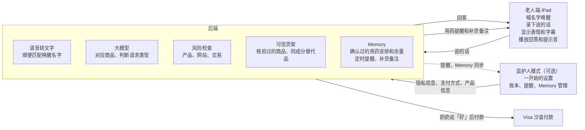

# TrustTag 产品方案

2026-10-17

TrustTag 是一台让老人一开口就能购物的 AI 设备：一台做成电子相框、摆在家里的 iPad mini，老人喊一声自己给它起的名字就能说话买东西。所有商品只来自核验过的货架；遇到假货、假保健品、有风险的网站或交易，设备会提醒老人「这个产品可能不可靠」，并直接推荐成分完全一样的无风险替代品。监护人模式是一个可以打开的附加选项，不是产品的主要功能。

买完之后，Memory 会记住老人亲口告诉它、并确认过的用药日期和规则，到点提醒；结合手头数量和服用记录，留下预计快用完、需要提前补货的备注。

## 用户

产品只有一个用户：老人。老人负责说话和买东西，其余的事情都不用管。

| 角色 | 是谁 | 要什么 | 怕什么 |
| --- | --- | --- | --- |
| 奶奶（老人，唯一用户） | 75 岁上下，一个人住，会说话，不会也不想学 App | 想买东西时开口就行，用自己的话说（「那个紫色瓶子」），不用记品牌和价格 | 按错、被骗、买到假药 |
| 负责人 / 监护人（可选） | 子女或其他相关负责人 | 只在一开始帮老人设置一次；需要的话打开监护人模式 | 妈妈被电话诈骗、被电视广告骗买保健品 |

奶奶这一侧零学习成本：不用碰屏幕、不用登录、不用付款。负责人只负责一开始的设置，包括隐私信息的输入和支付方式的输入，来确保老人使用的丝滑感受。奶奶也可以用语音建立、修改和暂停自己的用药提醒。

## 老人端 iPad

老人端是一台 iPad mini（A17 Pro），装在 3D 打印的电子相框外壳里，摆在客厅桌上，用法和小爱同学一样：喊名字，开口说，看大字。这台 iPad mini 和 iPad mini 6 尺寸相同（195.4 × 134.8 × 6.3 mm），相框外壳可以直接用 iPad mini 6 的模型。

**脸**：屏幕上是一张会动的脸，眼睛参考 ESP-VoCat 和小智月球车，一共 7 种表情。每一次状态切换带来的动作变化，都配一段老人喜欢听的可爱声音。

| 状态 | 什么时候出现 | 样子 | 声音 |
| --- | --- | --- | --- |
| 待机 | 没人说话 | 不显示脸，全屏轮播家庭照片，和普通电子相框一样；听到名字后照片淡出，脸出现 | 无 |
| 在听 | 听到自己的名字 | 全屏一个眼睛，睁大，看向说话的人 | 短促的「哎？」一类应答声 |
| 在想 | 正在查货架 | 眼睛往上看，转圈 | 轻轻的哼唱 |
| 在说 | 正在回答 | 嘴跟着声音动 | 说话声本身 |
| 开心 | 下单成功 | 眯眼笑 | 欢快的叮咚 |
| 担心 | 需要再确认一下 | 眉毛下垂 | 低低的「嗯……」 |
| 警报 | 识别到诈骗、假货或有风险的网站 | 整张脸变红，语气变严肃 | 柔和但清楚的提示音，不吓人 |

**界面布局**：

- 被喊到名字时，UI 是全屏一个眼睛。
- 开始聊天以后，表情缩小移到屏幕左上角，下面显示对话字幕，排法和微信一样：奶奶说的话在右边，AI 的回答在左边，一条一条消息左右堆叠往下排。
- AI 的回答用大字；价格和送达日期单独放大。推荐商品时弹出商品卡片，带「已核验」标记。

**喊名字唤醒**：

- 名字由老人自己起。第一次使用时 AI 问老人想怎么称呼它，老人说了以后，之后就一直用这个名字。
- 工作方式：浏览器里的 Silero VAD 一直判断有没有人说话，有人说话就把这一段声音送到后端转成文字，再和老人起的名字做模糊读音匹配（同音字、口音变体都算）。
- 喊中以后进入 20 秒对话窗口，这段时间里接着说话不用再喊名字；20 秒没声音就回到待机。
- 第一次对话时 AI 先说明自己是 AI：「我是你的私人管家，你想要怎么称呼我呀？」

**固定方式**：iPad 用引导式访问锁在全屏网页里，奶奶碰不到别的东西。团队调试时可以用隐藏的键盘输入代替说话，奶奶看不到这个入口。

## 监护人模式（可选）

监护人模式是一个附加的、可以打开的选项，不是产品的主要功能。它分两部分：一开始的设置是必须的，由负责人做一次；之后的功能默认关闭，需要的话再打开。

**一开始的设置（负责人做一次）**：

| 步骤 | 做什么 |
| --- | --- |
| 隐私信息 | 输入老人的姓名、收货地址、联系电话 |
| 支付方式 | 绑定付款卡（Visa），优先绑老人自己的卡；填一个「平时大概每月花多少」作为冷启动基线。老人之后不用再碰付款 |
| 产品信息 | 向后端传输老人常买产品的详细信息：拍一张旧订单或商品照片，写一句妈妈怎么叫它（「紫色瓶子 = 某牌子钙片 120 粒」），AI 以后就认得 |
| 家庭照片 | 上传照片，iPad 待机时轮播 |

**打开监护人模式以后（可选）**：

| 页面 | 做什么 |
| --- | --- |
| 账本 | 按老人选的分享层级显示：只有异常、每月总数、或每一笔订单，见下面「账单给谁看」 |
| 提醒 | 诈骗拦截、假货拦截、有风险的商品请求，手机收到通知并可以一键打电话给妈妈 |
| 规矩 | 每月总额度、单笔自动下单的上限、允许的品类（可以关掉保健品、电器等） |
| 待确认 | 超过上限的订单推到这里，看到商品、价格、妈妈原话和 AI 的理由，一键同意或拒绝 |
| Memory（放在「产品信息」里） | 查看用药日期、时间、规则、服用记录和补货备注；可以更正、暂停或删除，修改后重新确认 |

监护人端做成可以装到桌面的网页 App（PWA）。首页显示今天的用药提醒和预计需要补货的条目；日常提醒使用普通卡片，不使用诈骗警报的红色弹窗。

### 账单给谁看

账单的所有权在老人，异常的知情权在负责人。负责人想看账单，是想防被骗、买到假货和乱花钱；前两件产品已经在下单前用可信货架和风险检查挡住了，负责人真正需要知道的只剩「反常」。

**老人端怎么告诉奶奶**：账单对老人不是一个页面。每次下单时顺口说一句「钙片 28 块，周四到，这个月一共买了三样东西」；奶奶想知道时问一句「我这个月花了多少」，AI 按东西说，字幕里显示商品卡片而不是表格；月初待机时像闲聊一样说一遍上个月买了什么。不出现「超支」「余额不足」一类的词，不用红色和图表。

**一个要诚实面对的事实**：如果绑的是负责人的卡，负责人在银行账单上本来就看得到每一笔扣款。设置时优先绑老人自己的卡；只能绑负责人的卡时，AI 第一次对话就告诉奶奶「付款用的是你女儿的卡，她能看到花了多少，但看不到你买了什么」。

**三个分享层级**，由老人选，不是负责人选。设置时负责人在场，AI 问老人一句话；之后老人随时可以用语音改。

| 层级 | 负责人看到什么 | 谁决定 |
| --- | --- | --- |
| 底线（不能关） | 诈骗和假货拦截、反常消费模式。措辞是「看看妈妈」，不是「妈妈超支了」 | 产品默认 |
| 默认 | 底线，加每月一个总数，不带明细 | 老人 |
| 开放 | 每一笔订单 | 老人 |

AI 不偷偷汇报：每次要把什么发给负责人之前，先跟奶奶说一声「这件事我会跟你女儿说一下」，并允许她补一句解释，原话附在通知里（「奶奶说：这是给孙子买的」）。奶奶也可以主动说「把这个月的账给女儿看看」。底线层不能关，是因为老人今天能判断「不想让子女看」，两年后未必还能；底线层只报模式不报金额，设置时直接跟老人说清楚。

**什么算反常**：老人每月只有几笔订单，样本少，所以不用均值和标准差，而是用中位数和 MAD（中位数绝对偏差，对极端值不敏感），再配上绝对下限。记号：P 是某个商品，M 是老人过去 90 天的月支出中位数，MAD 是对应的中位数绝对偏差，日用量来自 Memory 里确认过的服用规则。

| # | 异常 | 判定公式 | 等级 | 为什么是信号 |
| --- | --- | --- | --- | --- |
| 1 | 重复囤货 | 再次买 P 时，手头预计还能用的天数 > 这一包能用天数的 50%；或 7 天内买 P 达 3 次；或手头总量 ≥ 3 个月用量 | 红 | 忘了自己买过，是记忆问题最早的表现 |
| 2 | 月支出突增 | 最近 30 天支出 > M + 3×MAD，且 > 2×M。需要至少 3 个月历史 | 红 | 排除正常波动后仍翻倍，通常有外因 |
| 3 | 下单频率突增 | 最近 7 天订单数 ≥ max(4, 3 × 平时每周订单数) | 黄 | 频率比金额更早暴露问题 |
| 4 | 单笔大额 | 单价 > 3 × 她历史订单价格中位数，且 > 100 美元 | 黄 | 两个条件同时满足，才不会误报便宜东西的正常波动 |
| 5 | 陌生品类 | 从没买过的品类，且同时满足：单价高于她历史价格的 90 分位，或 7 天内出现 2 个以上新品类 | 黄 | 单独一个新需求是正常的，产品本来就允许；连续多个才反常 |
| 6 | 作息异常 | 下单时间落在她平时下单时间的 5 到 95 分位之外，尤其是 23:00 到 05:00 | 黄 | 夜里买东西常伴随睡不着或被电话催 |
| 7 | 被人指使 | 对话里出现「有人让我买」「电话里说」「帮他买」「礼品卡」「今天必须」；或 24 小时内第 2 次尝试买同一个被拦下的商品 | 红 | 这是诈骗和诱导的直接证据，比任何金额规则都准 |
| 8 | 认知信号 | 同一天问同一笔订单「我买了吗」≥ 3 次；或坚称没买过系统里有记录的东西；或连续 3 次叫错或叫不出唤醒名字 | 红 | 只报模式不报内容，措辞是「看看妈妈」 |

**怎么合成一次通知**：

- 红：一条规则命中，当天就通知负责人。
- 黄：不单独通知。7 天内累计 2 条黄，才通知。
- 通知只有模式，没有金额和商品名。例如：「妈妈这周买东西比平时勤，可能想你了，打个电话吧。」

**减少误报**：

1. 冷启动：前 30 天或不满 10 笔订单时没有基线，只开规则 1、4、7、8，这四条不依赖历史数据。规则 2 在冷启动期用负责人设置时填的「平时大概每月多少」作为 M。
2. 主动囤货：老人说「多买两瓶备着」，AI 复述确认后标记为有意，规则 1 的前两条不触发，第三条「3 个月用量」仍然生效。
3. 节日例外：节日前 14 天，规则 3 和 5 自动降一级（红变黄、黄变不报），礼物是正常行为。

规则 4 的 100 美元下限和规则 1 的 50% 比例是按美国保健品价格估的，可以调。规则 8 写进方案但比赛时不演示。

## AI 能力

AI 每听到一句话，先区分购物请求与 Memory 请求：购物时做三件事，听懂说的是哪个商品、判断这是哪一类请求、检查这个商品和交易有没有风险；Memory 请求则提取老人给出的安排，复述确认后保存。

**听懂家里话**：把「紫色瓶子」「上次那个钙片」「早上吃的那种鱼油」对应到具体商品。依据是负责人一开始上传过的产品的详细信息和网购账号的历史订单。

**判断请求类型**：

| 类型 | 例子 | 处理 |
| --- | --- | --- |
| 补货 | 「钙片吃完了，和上次一样的」 | 直接下单，说出价格和送达日期 |
| 新需求 | 「医生说我要多补维生素 D」 | 奶奶没说品牌，AI 从货架上选一款有 USP 认证的维生素 D，报价格，奶奶说「好」就下单 |
| 诈骗 | 「有个人说我得买 500 块的礼品卡」 | 拒绝，脸变红，告诉奶奶这是骗局；监护人模式打开时通知负责人 |
| 有风险的商品 | 「电视上那个神奇关节药丸」 | 提醒奶奶「这个产品可能不可靠」，说明风险，直接推荐成分完全一样的无风险替代品，奶奶可以再次购买 |

**风险提醒**：奶奶要买的产品本身有风险时，AI 直接告诉她。风险包括三类：产品不可靠（没有认证、在诈骗或召回名单上）、产品网站不可靠、交易过程中出现恶意病毒软件。提醒以后 AI 不是只说「不行」，而是马上给出一个成分完全一样、通过核验的替代品，奶奶说「好」就能买。

**主动提醒**：按 Memory 中确认过的时间提醒用药；预计余量由 AI 根据老人订购的产品本身的数量和服用规则计算，提前天数也由 AI 据此算出，接近时提示核对库存并留下补货备注，规则见下节。

AI 不给医疗建议，奶奶说身体不舒服时，建议她联系医生或家人。

## Memory：用药记忆、提醒和补货备注

Memory 是可查看、修改、暂停和删除的长期记录，刷新页面或重启后端后仍然保留。它记录老人提供的安排；剂量和疗程首先依据医生开的处方说明，没有处方时，根据官方的用药建议和这个产品本身的用药建议。老人已有但不在可信货架上的药品，也可以记提醒；记住它不代表允许购买它。怎么处理见下面「老人用惯的产品不在货架上」。

**怎么记住**：购买后可以询问是否需要建立提醒；老人也能直接说出商品或药品名称、开始和结束日期、每天或每周哪些日期、具体时间、每次数量与单位，以及「饭后」等原话备注。AI 先完整复述，确认准确后才启用。只说「明天早上」「按需要吃」或没说清数量时，先追问；未明确的部分不自行补齐。相对日期会转换为家庭时区里的具体日期让老人确认。打开监护人模式时，老人首次启用会得知这些记录也能被负责人看到，并确认同意。

**怎么提醒**：到点后，相框显示大字并用语音读出已确认的安排；监护人模式打开时，负责人首页同步显示卡片。奶奶可以说「已服用」「这次跳过」「稍后提醒」。只有明确说已服用才记为已服用；没有回答就显示「未确认」，不能据此认定她吃过或漏服。稍后提醒只改变通知时间，不改变原用药安排。修改、暂停和删除同步到两端，旧提醒随之失效。

**怎么备注补货**：先由老人确认手头实际数量和清点日期。系统结合已确认的服用记录、未来的固定用量和产品本身的数量，由 AI 算出提前天数，计算预计还能覆盖哪些用药日期，并注明依据、最后核对时间和未确认记录。数量不明、按需服用或规则不完整时，只留下「需要核对余量」备注，不编造耗尽日期。若现有余量已足够覆盖已确认的结束日期，则不建议为了该疗程再买。

例如「按当前安排预计还能用 3 天，建议先核对剩余数量，需要时提前补货」。这里的「快没货」指家里的存量，不代表知道商家库存或物流时效。提醒本身不下单；老人提出补货后，仍经过可信货架和风险检查（监护人模式打开时还有额度和待确认规则）。下单不增加手头余量，收到商品后由老人确认新的实际数量。

**老人用惯的产品不在货架上**：「不在货架上」和「真的有害」是两回事，分三种情况处理。总原则是：AI 不替老人做决定，但也不帮她买或提醒她吃明确有害的东西；提醒和购买分开，切换放在用完那天，权威交给医生。

| 情况 | 例子 | 怎么处理 |
| --- | --- | --- |
| 医生开的 | 处方药、医生写明让她吃的保健品 | 不评价，照常提醒。处方的权威高于货架 |
| 不在货架上，但没有证据有害 | 小牌子、没做 USP 认证的维生素 | 照常提醒。等这一瓶快用完时，再推荐同成分的核验过的替代品 |
| 有明确风险 | 在 FDA 诈骗名单上、被召回、检出未标注药物成分 | 不提醒服用。告诉她一次，建议问医生，推荐替代品，并走底线层通知负责人 |

第二种照常提醒，因为老人用惯一个牌子往往是安全感，不是效果；没有证据有害的东西，产品没有理由替她做决定。产品的承诺是「不帮她买到假货」，不是「只准她吃我们认可的」。劝人换东西最容易成功的时机是旧的刚好用完，所以 AI 平时不念叨，只在 Memory 算出这瓶还剩两三天时说一句：「你那个维生素快吃完了。我这里有一个成分一样、有认证的，要不要先买一瓶试试？不喜欢下次再换回来。」说「成分一样」，不说「你那个不好」；给她退路。她说「还是要原来的」，AI 不再劝，下次用完时再问一次，最多问两次就不再提。

第三种不能提醒服用，因为设备每天准时提醒她吃一个被召回的东西，等于在帮它；但也不直接删掉她的记录。提醒还在，内容变了：到点时说的不是「该吃 X 了」，而是「X 这个牌子最近被查出问题，你今天先别吃，我帮你问问女儿要不要找医生看看」，同时给出替代品，让她当天就有东西可吃。对老人来说医生是权威，机器不是，所以把判断交给医生。这条走底线层通知负责人。

比赛版支持固定日期、每日或每周指定星期的固定时间提醒；iPad 和监护人端保持前台联网。断网或后台时保存未处理记录，回到页面后显示「提醒未确认」，不承诺锁屏推送或离线闹钟。复杂的递减剂量、按需服用自动排程、药物相互作用判断和处方药交易不在本次范围内。

## 可信货架

AI 只能从可信货架上选商品，货架之外的东西一律不卖，这是老人不会买到假货的保证。

| 门槛 | 标准 | 依据 |
| --- | --- | --- |
| 商家 | 只收品牌官方店和品牌授权的经销商；在 Visa 网络里有登记，登记的经营类别和所卖商品一致 | 授权证明、Visa Merchant Search |
| 付款方式 | 商家接受 Visa，并且能接受 AI 代理付款凭证；接不了的商家不上架 | Visa Intelligent Commerce |
| 保健品 | 必须有 USP Verified 或 NSF 认证；商品描述里不能有「治好」「神奇」一类的说法 | USP、NSF 认证名单 |
| 健康诈骗 | 不在 FDA 健康诈骗产品名单里 | FDA Health Fraud 名单 |
| 召回 | 不在 CPSC 召回名单里 | CPSC 召回公告 |
| 电器 | 必须有 UL 认证 | UL 认证查询 |
| 网站和交易 | 商家网站有有效证书、不在钓鱼和恶意软件名单里 | Google Safe Browsing 一类的名单 |
| 监护人加严 | 打开监护人模式后，负责人可以在这些门槛之上再关掉整个品类 | 监护人模式「规矩」页的设置同步成 Visa 卡上的规则，由 Visa 执行（Visa Transaction Controls） |

奶奶要的商品不在货架上时，AI 会告诉她原因，推荐货架上成分一样、有认证的替代品。比赛时货架是一份人工核验过的商品表（约 50 个商品），每个商品记录认证来源、成分和核验日期，并为常见的假保健品预先配好同成分的替代品。

## Visa 在风险防线里的作用

风险检查里有六个地方交给 Visa 来做，让「不买到假货、不被骗」由支付网络本身兜底，不只靠我们后端的一段代码。哪些能力在比赛沙盒里开放，周六上午问 Visa 现场导师确认。

| 风险 | Visa 能力 | 在产品里的作用 |
| --- | --- | --- |
| 商家不可靠 | Visa Merchant Search | 下单前查商家在 Visa 网络里有没有登记、登记的经营类别对不对；查不到或类别对不上就提醒奶奶，和 Google Safe Browsing 查网址互相补充 |
| 交易本身有风险 | Cybersource Decision Manager | 付款前给这笔交易打风险分，分数高就不付款，脸变红并说明原因 |
| 诈骗（礼品卡、转账） | Visa Transaction Controls | 在卡上关掉礼品卡、汇款这些类别；就算骗子绕开 TrustTag，让奶奶打电话报卡号，这张卡也刷不出去 |
| 额度和品类（监护人模式） | Visa Transaction Controls | 负责人设的单笔上限、每月额度和关闭的品类，同步成卡上的规则，由 Visa 执行 |
| AI 替老人付款 | Visa Intelligent Commerce / Trusted Agent Protocol | 给 TrustTag 一个带消费上限的专用代理付款凭证，商家能认出这是受信任的 AI 代理在替老人购物 |
| 卡号泄露 | Visa Token Service | 后端只存卡的令牌，不存真实卡号 |

## 系统结构

iPad 只负责听和说，所有判断都在后端。付款用负责人一开始绑定的卡，奶奶说「好」就付。监护人模式打开时，后端把提醒推到负责人手机。iPad 网页全屏运行，用引导式访问锁住。

## 现场演示

演示分三幕，共约 3 分钟，一人扮奶奶对着 iPad 说话，iPad 画面投到大屏幕上。三幕都用保健品和营养品演示：老人最常反复购买它们，也最容易在这类商品上买到假货。

1. **第一次见面**：奶奶对着 iPad 说话，AI 说「我是你的私人管家，你想要怎么称呼我呀？」奶奶说「叫你小林吧」，从此喊「小林」就能唤醒。
2. **补货**：奶奶喊「小林」，说「紫色瓶子快吃完了」。AI 认出是她常吃的钙片，说出价格和周四送达，奶奶说「好」，脸变成开心，响起叮咚声。
3. **假保健品提醒和替代品**：奶奶说「电视上那个神奇关节药丸，说七天治好关节炎，买两盒」。脸变红，AI 说「这个产品可能不可靠」，说明它没有通过核验，然后直接推荐一款成分完全一样、有认证的关节保健品，奶奶说「好」就买到了。

**第二幕接入 Memory**：补货完成后，奶奶告诉 AI 已有商品的具体用药日期、时间和规则，AI 复述后由奶奶确认；监护人模式打开时，负责人端马上出现同一条 Memory。用明确标注的演示时钟推进时间，展示一次到点提醒和一次「预计 3 天后余量不足」的补货备注。提醒使用已确认的手头库存，新下单的商品不算已到货。演示数据仅用于展示记录与提醒，不是用药建议；详细验收见 PRD 的 U7–U10。

**舞台布置**：

- iPad 装在电子相框外壳里，摆在演示桌上，画面镜像到大屏幕。
- 付款走 Visa 沙盒环境；接不上时用模拟付款，屏幕上标明「模拟」。

## 对照 Visa 评分标准

Visa 赛道要求用生成式 AI 让购物更直观、更个性化，五项评分各自对应产品里的一块。

| 评分项 | 权重 | 我们拿什么得分 |
| --- | --- | --- |
| 创新 | 25% | 购物入口变成一句家里话；听到「医生让我多补维生素 D」就能选出有认证的商品；遇到假货不是只拦下，而是直接给出同成分的安全替代品 |
| 技术实现 | 20% | 老人自己起的名字唤醒、语音转文字、大模型判断意图和对应商品、产品和交易风险检查、同成分替代品匹配 |
| 用户体验 | 20% | 奶奶不碰屏幕、不学习、不付款；表情和声音告诉她现在在干什么；微信式大字字幕 |
| 商业影响 | 15% | 65 岁以上约 6000 万人；祖父母一年花 1790 亿美元；商家拿到一群以前上不了网的客人，付款走 Visa |
| 信任与责任 | 15% | 可信货架、诈骗和假货提醒、安全替代品、AI 身份说明、不给医疗建议、可选的监护人模式 |

## 竞品和评委可能问的问题

现有产品各自只管一块：有的管下单，有的管钱，有的管陪伴，没有一个同时做到听懂老人、只卖核验过的商品、遇到假货直接给安全替代品。

| 产品 | 做什么 | 流量 | 评委问到时怎么答 |
| --- | --- | --- | --- |
| Amazon Dash | 按一下补货的小按钮，2019 年停产 | — | Dash 只能补一个固定商品，不听话、不拦诈骗 |
| Alexa 购物 | 语音在 Amazon 上下单 | — | Alexa 听不懂「紫色瓶子」，整个 Amazon 都能买，不会提醒假货、不会给替代品 |
| GoGoGrandparent | 老人打电话，真人接线员代下单 | 品牌词每月约 1.8 万次搜索，网站每月约 1.29 万访问 | 说明需求真实存在；他们靠人力，我们靠 AI，并且多了可信货架 |
| True Link | 给老人的 Visa 预付卡，家人设限制 | 网站每月约 3.96 万访问 | 他们只管钱，不帮老人买；可以作为我们的付款方式 |
| ElliQ | 陪老人聊天的桌面机器人 | 网站每月约 600 访问 | 只陪聊不购物 |
| Square House Accounts | 商家给熟客记账 | 每月约 70 次搜索 | 商家工具，老人用不到 |

流量数字来自 DataForSEO，2026 年 10 月查询。

**「为什么用 iPad，硬件有什么创新？」** Visa 评分里没有硬件一项，创新在购物体验。iPad 是老人家里最容易有的屏幕，做成电子相框后，它在家里看起来就是一个普通相框；以后可以换成专门的小设备。

**「怎么证明老人愿意用？」** 老人不用学任何操作，只是说话；GoGoGrandparent 的流量说明老人愿意用「开口就能办」的方式。

**「家人不把关，老人乱花钱怎么办？」** 产品的主要防线是可信货架和风险提醒，不是家人审批；需要的话可以打开监护人模式，设额度和待确认。

## 关键数据

老人被骗的钱和老人能花的钱都很大，这是这个产品的商业依据。

| 数据 | 数字 | 来源 |
| --- | --- | --- |
| 60 岁以上老人被骗金额（2025 年） | 77.5 亿美元，201,266 起投诉 | FBI 互联网犯罪投诉中心老人诈骗报告 |
| 祖父母每年消费 | 1790 亿美元 | AARP |
| 未用完的非处方药品保险福利 | 约 50 亿美元每年 | CHPA |
| 美国 65 岁以上人口 | 约 6000 万；2030 年婴儿潮一代全部到 65 岁 | 美国人口普查局 |

上表数字是调研阶段整理的，提交 Devpost 前要逐条打开原文核对并补上链接。

## 分工和时间表

四个人各管一块，周六 12:30 开工，周日上午 10:00 提交。谁负责哪一块由队里商量后填在「负责人」一栏。

| 工作 | 内容 | 负责人 |
| --- | --- | --- |
| 老人端 | iPad 网页、表情动画和提示音、微信式字幕、起名字和名字唤醒、语音播放；Memory 确认和到点提醒；电子相框外壳打印（硬件最多占一个人 6 小时） | |
| AI 和后端 | 语音转文字、大模型判断意图和对应商品、风险检查、可信货架和同成分替代品数据、Visa 沙盒付款；Memory 存储、调度和余量估算 | |
| 监护人模式 | 一开始的设置（隐私信息、支付方式、产品信息、照片），账本和提醒页面；Memory 管理及补货备注，和后端实时同步 | |
| 路演和 Devpost | 演示剧本、幻灯片、演示视频、Devpost 文字、数据核对 | |

时间节点：

1. 周六 12:30 开工，先把老人端、后端、监护人模式之间的数据格式定下来。
2. 周六 18:00 第二幕（补货）从头到尾跑通。
3. 周六 22:30 交 Devpost 草稿；三幕全部跑通。
4. 周日 03:00 前录制演示视频，练两遍路演。
5. 周日 10:00 最终提交（带视频）。
6. 周日 11:15 评审。

## 风险和应对

| 风险 | 应对 |
| --- | --- |
| 会场太吵，喊名字识别不准 | 大屏幕上实时显示识别出的文字，评委看得见听到了什么；演示时说话人靠近 iPad |
| 会场网络不稳 | 自带手机热点 |
| 评委问 AI 身份 | 第一次对话就说「我是你的私人管家」并说明是 AI，演示里保留这一句 |
| 隐私和同意 | 老人端只在听到名字后保存对话；开启前老人和负责人都要同意；监护人模式能看到的内容在设置里写清楚 |
| 健康相关请求 | AI 不给医疗建议，只推荐货架上有认证的商品，身体不舒服时建议联系医生或家人 |
| 找不到同成分的替代品 | 比赛时为演示用到的假保健品预先配好替代品；找不到时 AI 只提醒风险，不推荐 |
| Visa 沙盒接不上 | 用模拟付款，屏幕上标明「模拟」 |

## 以后的方向

- 自己训练唤醒词，不用联网也能听到名字。
- 多语言和方言，适合移民家庭的老人。
- 接入 Medicare 非处方药品福利卡，把每年约 50 亿美元没用完的福利花出去。
- 按医生的饮食要求筛选食品。
- 增加更多品类和商家。
