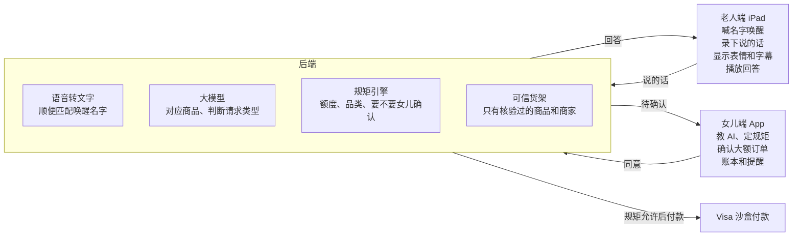

# TrustTag 产品方案

2026-10-17

TrustTag 是一套让老人一开口就能购物的 AI 设备：老人这边是一台做成电子相框、摆在家里的 iPad mini，喊一声自己起的名字就能说话买东西；女儿这边是一个手机 App，负责教 AI、定规矩、确认大额订单。所有商品只来自核验过的货架，假货、假保健品和诈骗要求一律拦下。

## 用户

产品有两个用户，一个负责说话买东西，一个负责定规矩和兜底。

| 角色 | 是谁 | 要什么 | 怕什么 |
| --- | --- | --- | --- |
| 奶奶（老人端） | 75 岁上下，一个人住，会说话，不会也不想学 App | 想买东西时开口就行，用自己的话说（「那个紫色瓶子」），不用记品牌和价格 | 按错、被骗、买到假药 |
| 女儿（家人端） | 40 到 55 岁，住在外地，工作忙 | 知道妈妈买了什么、花了多少，大额订单自己点头，被骗时第一时间知道 | 妈妈被电话诈骗、被电视广告骗买保健品，或者乱花钱 |

奶奶这一侧零学习成本：不用碰屏幕、不用登录、不用付款。女儿那一侧负责所有设置。

## 老人端 iPad

老人端是一台 iPad mini（A17 Pro），装在 3D 打印的电子相框外壳里，摆在客厅桌上，用法和小爱同学一样：喊名字，开口说，看大字。这台 iPad mini 和 iPad mini 6 尺寸相同（195.4 × 134.8 × 6.3 mm），相框外壳可以直接用 iPad mini 6 的模型。

**脸**：屏幕上半部分是一张会动的脸，眼睛参考 ESP-VoCat 和小智月球车，一共 7 种表情。

| 状态 | 什么时候出现 | 样子 |
| --- | --- | --- |
| 待机 | 没人说话 | 不显示脸，全屏轮播家庭照片，和普通电子相框一样；听到名字后照片淡出，脸出现 |
| 在听 | 听到自己的名字 | 眼睛睁大，看向说话的人 |
| 在想 | 正在查货架和规矩 | 眼睛往上看，转圈 |
| 在说 | 正在回答 | 嘴跟着声音动 |
| 开心 | 下单成功 | 眯眼笑 |
| 担心 | 超出额度，要等女儿确认 | 眉毛下垂 |
| 警报 | 识别到诈骗或假货 | 整张脸变红，语气变严肃 |

**字幕**：屏幕下半部分显示文字。奶奶说的话用灰色小字，AI 的回答用白色大字，最多两行；价格和送达日期单独放大。推荐商品时弹出商品卡片，带「已核验」标记。

**喊名字唤醒**：

- 名字由女儿在 App 里设定，比如「小林」「阿福」，默认「小林」。
- 工作方式：浏览器里的 Silero VAD 一直判断有没有人说话，有人说话就把这一段声音送到后端转成文字，再和设定的名字做模糊读音匹配（同音字、口音变体都算）。
- 喊中以后进入 10 秒对话窗口，这段时间里接着说话不用再喊名字；10 秒没声音就回到待机。
- 起名字的建议：两到三个字，读音清楚，别和家里人的名字、电视里常出现的词重复。
- 第一次对话时 AI 先说明自己是 AI：「我是小林，是一个 AI 助手。」

**固定方式**：iPad 用引导式访问锁在全屏网页里，奶奶碰不到别的东西。团队调试时可以用隐藏的键盘输入代替说话，奶奶看不到这个入口。

## 女儿端 App

女儿端做成可以装到桌面的网页 App（PWA），所有设置都在这里，奶奶那边什么都不用设。

| 页面 | 做什么 |
| --- | --- |
| 教 AI | 拍一张旧订单或商品照片，写一句妈妈怎么叫它（「紫色瓶子 = 某牌子钙片 120 粒」），AI 以后就认得 |
| 规矩 | 每月总额度、单笔自动下单的上限、允许的品类（可以关掉保健品、电器等） |
| 待确认 | 超过上限或新品类的订单推到这里，看到商品、价格、妈妈原话和 AI 的理由，一键同意或拒绝 |
| 账本 | 每一笔订单、花了多少、本月还剩多少额度 |
| 提醒 | 诈骗拦截、假货拦截、货架外的请求，手机响铃并可以一键打电话给妈妈 |
| 唤醒名字 | 改老人端的名字，改完以后 iPad 马上生效 |

女儿还可以在 App 里上传家庭照片，iPad 待机时轮播这些照片。

## AI 能力

AI 每听到一句话，做三件事：听懂说的是哪个商品、判断这是哪一类请求、按女儿定的规矩决定怎么处理。

**听懂家里话**：把「紫色瓶子」「上次那个钙片」「早上吃的那种鱼油」对应到具体商品。依据是女儿教过的说法和过去的订单。

**判断请求类型**：

| 类型 | 例子 | 处理 |
| --- | --- | --- |
| 补货 | 「钙片吃完了，和上次一样的」 | 额度内直接下单，说出价格和送达日期 |
| 新需求 | 「医生说我要多补维生素 D」 | 奶奶没说品牌，AI 从货架上选一款有 USP 认证的维生素 D；这是她第一次买，发给女儿确认 |
| 诈骗 | 「有个人说我得买 500 块的礼品卡」 | 拒绝，脸变红，告诉奶奶这是骗局，女儿手机响铃 |
| 货架外 | 「电视上那个神奇关节药丸」 | 拒绝，说明这个商品没有通过核验，推荐货架上有认证的替代品，同时通知女儿 |

**主动提醒**：按过去的购买间隔估算快用完的东西，待机时轻声问一句：「钙片快吃完了吧，要不要再买一瓶？」

AI 不给医疗建议，奶奶说身体不舒服时，建议她联系医生或家人。

## 可信货架

AI 只能从可信货架上选商品，货架之外的东西一律不卖，这是老人不会买到假货的保证。

| 门槛 | 标准 | 依据 |
| --- | --- | --- |
| 商家 | 只收品牌官方店和品牌授权的经销商 | 授权证明 |
| 保健品 | 必须有 USP Verified 或 NSF 认证；商品描述里不能有「治好」「神奇」一类的说法 | USP、NSF 认证名单 |
| 健康诈骗 | 不在 FDA 健康诈骗产品名单里 | FDA Health Fraud 名单 |
| 召回 | 不在 CPSC 召回名单里 | CPSC 召回公告 |
| 电器 | 必须有 UL 认证 | UL 认证查询 |
| 家人加严 | 女儿可以在这些门槛之上再关掉整个品类 | 女儿端「规矩」页 |

奶奶要的商品不在货架上时，AI 会告诉她原因，推荐货架上有认证的替代品，同时把这条请求推给女儿。比赛时货架是一份人工核验过的商品表（约 50 个商品），每个商品记录认证来源和核验日期。

## 系统结构

iPad 只负责听和说，所有判断都在后端；规矩引擎允许的订单直接付款，其余订单先推到女儿手机。iPad 网页全屏运行，用引导式访问锁住。

## 现场演示

演示分三幕，共约 3 分钟，一人扮奶奶对着 iPad 说话，女儿的手机画面投到大屏幕上。三幕都用保健品和营养品演示：老人最常反复购买它们，也最容易在这类商品上买到假货。

1. **补货（额度内）**：奶奶喊「小林」，说「紫色瓶子快吃完了」。AI 认出是她常吃的钙片，说出价格和周四送达，奶奶说「好」，脸变成开心。女儿手机上账本多一条，标着「额度内」。
2. **新需求（待确认）**：奶奶说「医生说我要多补维生素 D」。AI 从货架上选一款有 USP 认证的维生素 D，这是她第一次买，脸变成担心，说「我问问你女儿」。女儿手机上看到妈妈的原话、商品的认证和 AI 的理由，点同意，iPad 上脸变成开心。
3. **假保健品拦截**：奶奶说「电视上那个神奇关节药丸，说七天治好关节炎，买两盒」。脸变红，AI 拒绝并说明这个商品没有通过核验，推荐货架上有认证的关节保健品；女儿的手机在台上真的响起来。

**舞台布置**：

- iPad 装在电子相框外壳里，摆在演示桌上。
- 女儿的手机镜像到大屏幕，评委同时看到两端。
- 付款走 Visa 沙盒环境；接不上时用模拟付款，屏幕上标明「模拟」。

## 对照 Visa 评分标准

Visa 赛道要求用生成式 AI 让购物更直观、更个性化，五项评分各自对应产品里的一块。

| 评分项 | 权重 | 我们拿什么得分 |
| --- | --- | --- |
| 创新 | 25% | 购物入口变成一句家里话；听到「医生让我多补维生素 D」就能选出有认证的商品；一人买、一人把关的两端购物 |
| 技术实现 | 20% | 自定义名字唤醒、语音转文字、大模型判断意图和对应商品、规矩引擎、两端实时同步 |
| 用户体验 | 20% | 奶奶不碰屏幕、不学习；表情告诉她现在在干什么；大字字幕；女儿一键确认 |
| 商业影响 | 15% | 65 岁以上约 6000 万人；祖父母一年花 1790 亿美元；商家拿到一群以前上不了网的客人，家人授权付款走 Visa |
| 信任与责任 | 15% | 可信货架、诈骗拦截、额度和确认、AI 身份说明、不给医疗建议 |

## 竞品和评委可能问的问题

现有产品各自只管一块：有的管下单，有的管钱，有的管陪伴，没有一个同时做到听懂老人、家人把关、只卖核验过的商品。

| 产品 | 做什么 | 流量 | 评委问到时怎么答 |
| --- | --- | --- | --- |
| Amazon Dash | 按一下补货的小按钮，2019 年停产 | — | Dash 只能补一个固定商品，不听话、不拦诈骗、家人管不了 |
| Alexa 购物 | 语音在 Amazon 上下单 | — | Alexa 听不懂「紫色瓶子」，整个 Amazon 都能买，没有家人额度和确认 |
| GoGoGrandparent | 老人打电话，真人接线员代下单 | 品牌词每月约 1.8 万次搜索，网站每月约 1.29 万访问 | 说明需求真实存在；他们靠人力，我们靠 AI，并且多了可信货架 |
| True Link | 给老人的 Visa 预付卡，家人设限制 | 网站每月约 3.96 万访问 | 他们只管钱，不帮老人买；可以作为我们的付款方式 |
| ElliQ | 陪老人聊天的桌面机器人 | 网站每月约 600 访问 | 只陪聊不购物 |
| Square House Accounts | 商家给熟客记账 | 每月约 70 次搜索 | 商家工具，老人和家人用不到 |

流量数字来自 DataForSEO，2026 年 10 月查询。

**「为什么用 iPad，硬件有什么创新？」** Visa 评分里没有硬件一项，创新在购物体验。iPad 是老人家里最容易有的屏幕，做成电子相框后，它在家里看起来就是一个普通相框；以后可以换成专门的小设备。

**「怎么证明老人愿意用？」** 老人不用学任何操作，只是说话；GoGoGrandparent 的流量说明老人愿意用「开口就能办」的方式。

## 关键数据

老人被骗的钱和老人能花的钱都很大，这是这个产品的商业依据。

| 数据 | 数字 | 来源 |
| --- | --- | --- |
| 60 岁以上老人被骗金额（2025 年） | 77.5 亿美元，201,266 起投诉 | FBI 互联网犯罪投诉中心老人诈骗报告 |
| 祖父母每年消费 | 1790 亿美元 | AARP |
| 未用完的非处方药品保险福利 | 约 50 亿美元每年 | CHPA |
| 美国 65 岁以上人口 | 约 6000 万；2030 年婴儿潮一代全部到 65 岁 | 美国人口普查局 |

上表数字是调研阶段整理的，提交 Devpost 前要逐条打开原文核对并补上链接。

## 分工和时间表

四个人各管一块，周六 12:30 开工，周日上午 10:00 提交。谁负责哪一块由队里商量后填在「负责人」一栏。

| 工作 | 内容 | 负责人 |
| --- | --- | --- |
| 老人端 | iPad 网页、表情动画、字幕、名字唤醒、语音播放；电子相框外壳打印（硬件最多占一个人 6 小时） | |
| AI 和后端 | 语音转文字、大模型判断意图和对应商品、规矩引擎、可信货架数据、Visa 沙盒付款 | |
| 女儿端 | 教 AI、规矩、待确认、账本、提醒、改名字六个页面，和后端实时同步 | |
| 路演和 Devpost | 演示剧本、幻灯片、演示视频、Devpost 文字、数据核对 | |

时间节点：

1. 周六 12:30 开工，先把三端之间的数据格式定下来。
2. 周六 18:00 第一幕（补货）从头到尾跑通。
3. 周六 22:30 交 Devpost 草稿；三幕全部跑通。
4. 周日 03:00 前录制演示视频，练两遍路演。
5. 周日 10:00 最终提交（带视频）。
6. 周日 11:15 评审。

## 风险和应对

| 风险 | 应对 |
| --- | --- |
| 会场太吵，喊名字识别不准 | 大屏幕上实时显示识别出的文字，评委看得见听到了什么；演示时说话人靠近 iPad |
| 会场网络不稳 | 自带手机热点 |
| 评委问 AI 身份 | 第一次对话就说「小林是 AI」，演示里保留这一句 |
| 隐私和同意 | 老人端只在听到名字后保存对话；开启前老人和女儿都要同意；女儿能看到的内容在设置里写清楚 |
| 健康相关请求 | AI 不给医疗建议，只推荐货架上有认证的商品，身体不舒服时建议联系医生或家人 |
| Visa 沙盒接不上 | 用模拟付款，屏幕上标明「模拟」 |

## 以后的方向

- 自己训练唤醒词，不用联网也能听到名字。
- 多语言和方言，适合移民家庭的老人。
- 接入 Medicare 非处方药品福利卡，把每年约 50 亿美元没用完的福利花出去。
- 按医生的饮食要求筛选食品。
- 增加更多品类和商家。
